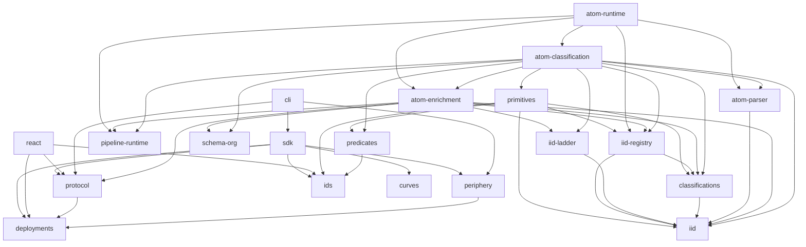

# Runtime dependency graph

Arrows point from each package to its runtime dependency. External contract artifacts are checked by the release gates.

Classification depends on enrichment helpers; enrichment never depends on classification. The composition root depends on both.
